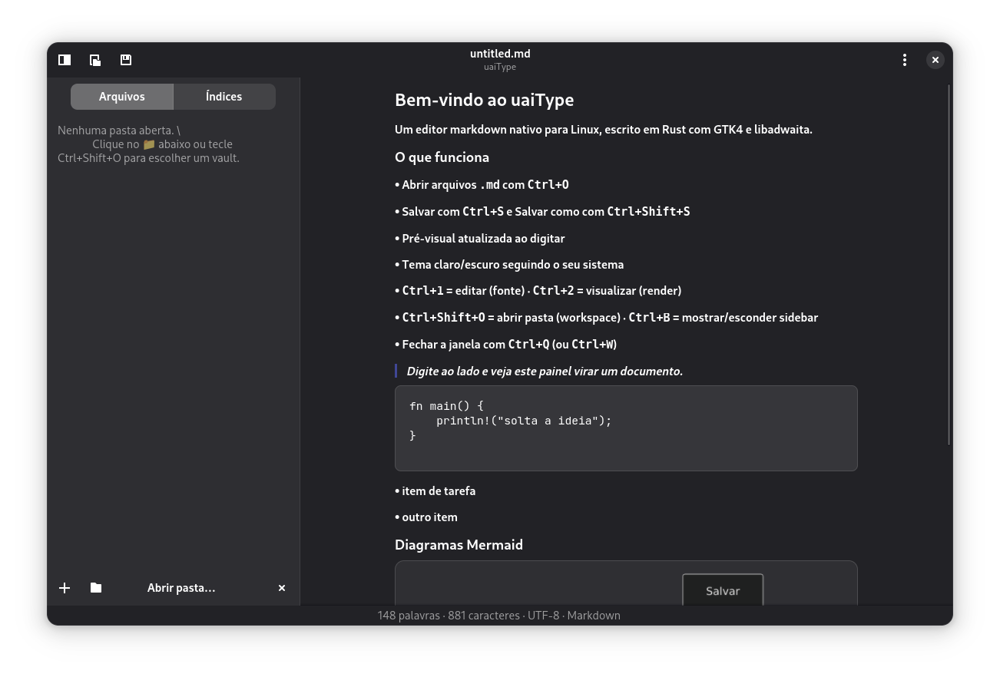

# uaiType

Um editor markdown **minimalista**, grátis e de código aberto.

Este repositório contém:

- **Landing page** — site estático pré-renderizado com `hono ssg` (Hono + JSX SSR gerado em build time, pasta `src/`), deployado no **GitHub Pages** pela GitHub Action `deploy.yml`
- **App nativo Linux** — `app/`: editor markdown nativo com **GTK4 + libadwaita** em Rust (Fase 1: abrir/salvar `.md`, sidebar de workspace, índice de `.md`s, mermaid e tabelas GFM no preview)



## Rodando o site (dev)

```sh
npm install
npm run preview      # build + preview em http://localhost:4173/uaitype/
```

Para iterar: edite `src/` e rode `npm run preview` de novo (o site é estático —
sem servidor em produção). Para checar uma resposta específica, use `hono request /`.

## Build estático e preview

```sh
npm run build        # pré-renderiza o site em dist/ (hono ssg)
npm run preview      # build + preview em http://localhost:4173/uaitype/
```

O build de produção usa `hono ssg` (pré-render oficial do Hono). Em produção o site é servido no **GitHub Pages** em `https://<owner>.github.io/uaitype/` — a base dos caminhos de assets (`base_path`/`BASE_PATH`, ver `src/base.ts`) é `/uaitype/`; no dev local usa `/`. O workflow `.github/workflows/deploy.yml` constrói e faz o deploy a cada push na `main` (requer `Settings → Pages → Source: GitHub Actions` no repo).

## Rodando o app nativo

Veja [`app/README.md`](app/README.md) — precisa dos pacotes de desenvolvimento do GTK4/libadwaita/SourceView5, depois `cargo run`.

## Licença

**MIT** — veja [`LICENSE`](LICENSE).

Em resumo: você pode usar, copiar, modificar, mesclar, publicar, distribuir, sublicenciar e/ou vender o uaiType, inclusive comercialmente; só precisa manter o aviso de copyright e esta licença. Sem copyleft, sem CLA, sem asteriscos.

O **nome** "uaiType" identifica o produto oficial; forks são permitidos, mas devem usar outro nome.
